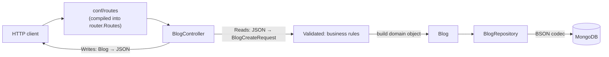

# play-intro

A hand-built **Play Framework 3 + Scala** sandbox. It's not meant to be a product. I'm using it to build a solid mental model of how Play works without any magic: compile-time DI with the cake pattern, play-json, MongoDB, and validation.

| | |
|---|---|
| Framework | Play 3.0 (`sbt-plugin` 3.0.12), sbt 1.12 |
| Language | Scala 2.13.18 |
| JSON | play-json |
| Storage | MongoDB 8 via `mongo-scala-driver` 5.13 |
| FP | cats-core (`Validated`) |
| DI | **Compile-time** (cake pattern), with no Guice wiring |

---

## Run it

```powershell
docker compose up -d; sbt run
```

```powershell
Invoke-RestMethod -Method Post -Uri http://localhost:9000/ -ContentType 'application/json' -Body '{"slug":"hello"}'
```

| Method | Path | What it does |
|---|---|---|
| `GET` | `/` | Hello from `GreetingService` (reads `zak.greeting` from config) |
| `POST` | `/` | Create a blog from a `BlogCreateRequest` → `201` + the blog JSON, or `400` with **every** validation error |
| `GET` | `/blog/:id` | Find a blog → `200` or `404` |

---

## Mental model

### 1. A request, end to end



### 2. Compile-time DI = the cake pattern

Play normally uses Guice (runtime DI). Here **everything is wired by hand, and the compiler checks it**.

```
conf/application.conf   play.application.loader = "wiring.AppLoader"
        │
        ▼
AppLoader.load()  ──►  new AppComponents(context).application
        │
AppComponents extends BuiltInComponentsFromContext   ← Play's own pieces (config, lifecycle, EC, ...)
                 with HttpFiltersComponents          ← default filters (CSRF, headers, hosts)
                 with ServiceComponents              ← greetingService
                 with RepositoryComponents           ← mongoClient, mongoDatabase, blogRepository
  lazy val homeController / blogController / router
```

Each `*Components` trait is a **slice of the object graph**:

```scala
trait RepositoryComponents {
  self: BuiltInComponents =>                       // "I can only be mixed into something that has Play's components"
  lazy val mongoClient: MongoClient = { ... }       // uses `configuration` and `applicationLifecycle` from the self-type
  lazy val blogRepository: BlogRepository = new MongoBlogRepository(mongoDatabase)(executionContext)
}
```

What I took away from this:
- **The self-type (`self: BuiltInComponents =>`)** is how a slice says what it *needs* without extending it. The compiler refuses to mix it into anything that doesn't provide those things.
- **Everything is a `lazy val`**, so the order of the mix-ins doesn't matter. Each value is built the first time it's used, exactly once.
- **Config is read in the wiring, not in services.** `configuration.get[String]("mongo.uri")` lives in `RepositoryComponents`, so services receive plain values and stay easy to test.
- **Resources get a stop hook.** `applicationLifecycle.addStopHook(() => Future.successful(client.close()))` closes the Mongo pool on shutdown and on every dev-mode reload.
- **Swapping an implementation is a one-line change in the wiring** (`blogRepository: BlogRepository = new MongoBlogRepository(...)` → an in-memory version for tests).

### 3. `conf/routes` is code, not config

The routes file is **compiled** into `router.Routes`, with one constructor parameter per controller it mentions. Adding `POST / → BlogController` changed that constructor, so `new Routes(httpErrorHandler, homeController)` stopped compiling until `blogController` was wired in. A missing route dependency is a **compile error, not a runtime surprise**. That's the whole point of compile-time DI.

### 4. JSON: `Reads` and `Writes`

| Type class | Direction | Used by |
|---|---|---|
| `Reads[A]` | JSON → Scala (`JsValue => JsResult[A]`) | `json.validate[A]` |
| `Writes[A]` | Scala → JSON (`A => JsValue`) | `Json.toJson(a)` |

What's in this codebase:

```scala
implicit val writes: Writes[BlogId] = Writes(id => JsString(id.value))        // hand-written: "abc", not {"value":"abc"}
implicit val writes: Writes[Blog]   = Json.writes                              // macro, which reuses Writes[BlogId] for the `id` field
implicit val reads: Reads[BlogCreateRequest] =
  Json.using[Json.WithDefaultValues].reads                                     // macro that uses case-class defaults for missing fields
```

- **Macros need an instance for every field type.** `Json.reads[Blog]` failed because there was no `Reads[BlogId]`. That's what pushed me toward a separate request type (below).
- **Implicits are found in companion objects**, so `Writes[BlogId]` in `object BlogId` is picked up with no import.
- **Plain `Json.reads` ignores default values.** You need `Json.using[Json.WithDefaultValues]` for that.
- **Trap: implicit `Writes[Option[T]]`.** `Json.toJson(maybeBlog)` compiles and turns `None` into `null`, so "not found" came back as `200 null`. Always pattern-match the `Option` first: `Some → Ok`, `None → NotFound`.

### 5. Request model ≠ domain model

```scala
final case class BlogCreateRequest(slug: String, description: String = "To fill in")  // what a client MAY send: only Reads
final case class Blog(@BsonProperty("_id") id: BlogId, slug: String, description: String)  // what we STORE: only Writes
```

The client can't send an `id`, because the request type doesn't have one. The server creates it (`BlogId.generate`). Each type only has the JSON direction it actually uses, so `validate[Blog]` won't even compile.

### 6. Three validation layers

| Layer | Where | Tool | Fails with |
|---|---|---|---|
| **Syntactic** (is the JSON shaped right?) | the edge | `request.body.validate[BlogCreateRequest]` | `400` + `JsError.toJson(errors)` |
| **Business rules** (does this make sense?) | controller → later the domain | cats `ValidatedNec[TodoError, A]` | `400` + `{"errors":[{"code","message"}]}` |
| **Set-based** (e.g. unique slug) | the database | unique index *(to do)* | `409` |

#### The "value or a reason why not" family

They're all the same shape (a value, or why there isn't one), which is why they all have `map`, `fold` and `getOrElse`:

| Type | Question it answers | Failure side |
|---|---|---|
| `Option[A]` | *Is there a value?* | `None` (no reason given) |
| `Try[A]` | *Did this code throw?* | `Failure(exception)` |
| `Either[E, A]` | *Did it work, and if not, why?* | `Left(error)`, **stops at the first error** |
| `Validated[E, A]` | *Is everything valid? Tell me all the problems.* | `Invalid(errors)`, **collects every error** |
| `JsResult[A]` | play-json's own hybrid | `JsError(errors per JSON path)` |

**Either or Validated?** Ask whether step 2 needs the result of step 1. If it does, it's a chain: `Either` / `for`. If the checks are independent (slug OK? description OK?), use `Validated` and report everything at once. `createBlog` uses both: `validate` → `validateBlog` → `save` is a chain, and the rules inside `validateBlog` are independent.

#### Accumulating validation with `ValidatedNec`

```scala
type ValidationResult[A] = ValidatedNec[TodoError, A]      // = Validated[NonEmptyChain[TodoError], A]

sealed trait TodoError { def message: String }             // typed errors, not raw strings
object TodoError {
  case object DescriptionBlank extends TodoError { val message = "Description is not on point." }
  case object SlugBlank        extends TodoError { val message = "Slug is not on point." }
}

private def validateSlug(slug: String): ValidationResult[String] =
  if (slug.trim.isBlank) SlugBlank.invalidNec else slug.validNec

private def validateBlog(payload: BlogCreateRequest): ValidationResult[BlogCreateRequest] =
  (validateSlug(payload.slug), validateDescription(payload.description)).mapN(BlogCreateRequest(_, _))
```

- **`Nec` = `NonEmptyChain`.** An `Invalid` always holds **at least one** error, and the type guarantees it. It's a `Chain` and not a `List` because combining results *appends* error collections, which is O(1) for `Chain` and O(n) for `List`.
- **`mapN`:** if every input is `Valid`, it calls your function with all the values. If *any* is `Invalid`, it skips the function and **combines all the errors**.
- **The HTTP side** turns the errors into JSON. A `case object`'s `toString` is its name, so you get a machine-readable `code` for free:

  ```scala
  BadRequest(Json.obj("errors" -> errors.toChain.toList.map(e => Json.obj("code" -> e.toString, "message" -> e.message))))
  ```

  ```json
  {"errors":[{"code":"SlugBlank","message":"Slug is not on point."},{"code":"DescriptionBlank","message":"Description is not on point."}]}
  ```

#### Traps I hit on the way

- **`mapN(payload)` → `found BlogCreateRequest, required (String, String) => BlogCreateRequest`.** `mapN` needs a *function* of N arguments, not a value. Read a type mismatch as "found X, required Y": if Y is a function type, you need something you can call.
- **`mapN(BlogCreateRequest)` doesn't compile either.** Once you write your own `object BlogCreateRequest`, the companion no longer works as a `(String, String) => BlogCreateRequest` function. Use `BlogCreateRequest(_, _)` or `BlogCreateRequest.apply`.
- **`_ => Json.obj(_)` is two separate lambdas.** Each `_` is a new parameter of the smallest surrounding expression, so this built a `List` of *functions*. As soon as you need the value inside a nested call, name it: `e => Json.obj("message" -> e.message)`.
- **Cats syntax comes from imports.** `.mapN`, `.validNec` and `.toList` are added by implicit conversions. If you (or the IDE's "optimize imports") pull in only some of them, the others silently vanish: `value toList is not a member of NonEmptyChain`. `import cats.syntax.all._` brings everything in; `errors.toChain.toList` needs no syntax import at all.
- **`case x =>` matches everything.** A lowercase name in a pattern is a *new variable*, not a comparison. The compiler says "patterns after a variable pattern cannot match / unreachable code".

### 7. `Action[A]`: `A` is the request *body* type

```scala
def createBlog(): Action[JsValue]  = Action.async(parse.json) { request => ... }   // body parsed as JSON
def findBlog(id: String): Action[AnyContent] = Action.async { ... }               // GET: default parser
```

Every action returns a `Result`. The type parameter only describes what `request.body` is, which explains the `found Action[AnyContent], required Action[JsValue]` error.

### 8. JSON ≠ BSON

`BlogId` has **two** serializers, for two different worlds:
- `Writes[BlogId]` (play-json) → what goes over **HTTP**
- `Codec[BlogId]` (BSON) → what goes into **Mongo**, registered in `MongoBlogRepository`'s `CodecRegistry` next to the `Macros` codec for `Blog`

`@BsonProperty("_id")` maps the `id` field onto Mongo's primary key. Saving uses `replaceOne(... , upsert = true)`.

### 9. Execution contexts: don't let the IDE pick one for you

To make `.map` compile on a `Future`, the IDE once auto-imported `org.apache.pekko.actor.TypedActor.dispatcher`. That one only works *inside a typed actor* and would have blown up at runtime. Controllers should use the EC Play wires for them:

```scala
private implicit val ec: ExecutionContext = defaultExecutionContext   // = controllerComponents.executionContext
```

Repositories get `executionContext` passed explicitly from the wiring.

---

## Project layout

```
app/
  controllers/   HomeController, BlogController         HTTP ⇄ domain, nothing else
  model/         BlogId, Blog, BlogCreateRequest        domain + request types, JSON/BSON instances
  repository/    BlogRepository (port), MongoBlogRepository, RepositoryComponents
  services/      GreetingService, ServiceComponents
  wiring/        AppLoader, AppComponents               the whole object graph, in one place
conf/
  application.conf   loader + mongo + app config
  routes             compiled into router.Routes
docker-compose.yml   MongoDB 8 (standalone)
```

---

## Next steps

- [x] `validateBlog` with accumulating `ValidatedNec[TodoError, _]` + `mapN`.
- [ ] Move `TodoError` and the validators from `BlogController` into `model` (they're domain rules). The controller should only translate errors into HTTP.
- [ ] `findBlog(id: BlogId)` via a `PathBindable[BlogId]` (UUID-validated, so a junk id → `400`). Put the binder in `controllers.binders` + `routesImport` to keep the domain free of `play.api.mvc`.
- [ ] Unique index on `slug` → `409 Conflict`.
- [ ] Tests (the generated `HomeControllerSpec` was removed when Guice was dropped).
